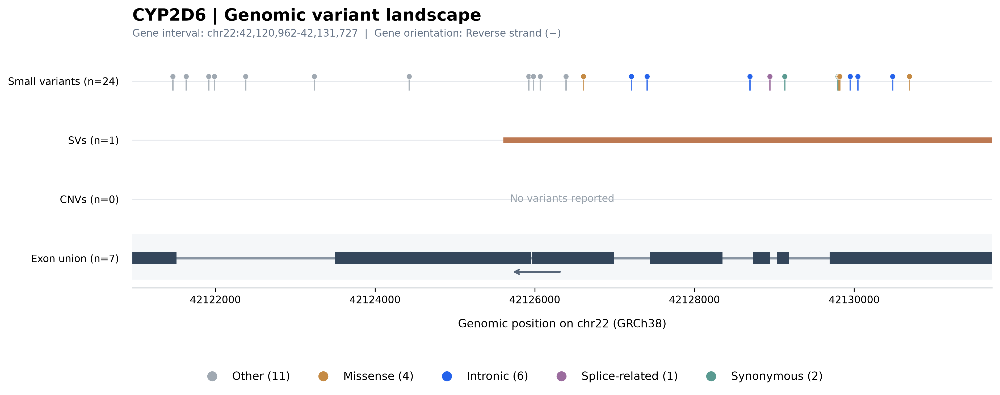
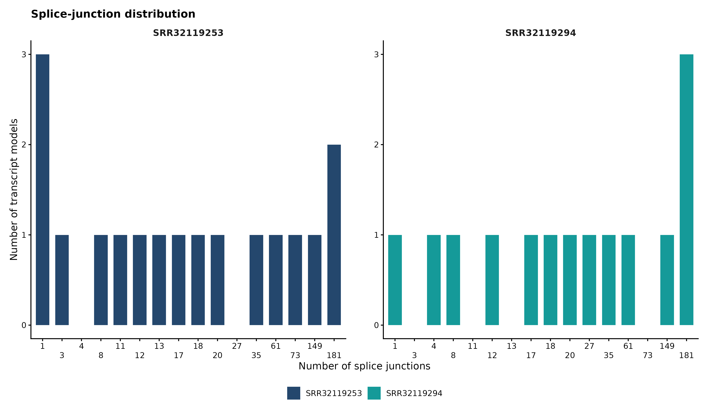
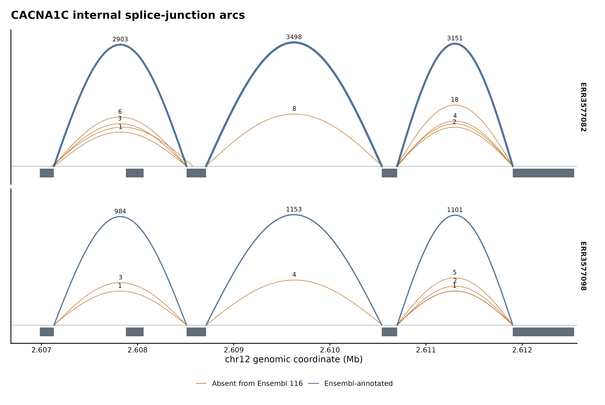

# NEB Nextflow

**A modular Nextflow DSL2 workflow for Oxford Nanopore long-read DNA and RNA sequencing analysis.**

NEB Nextflow was developed during a research internship at the UK Dementia Research Institute, University of Cambridge, within the Ryten Lab.

The project was motivated by the challenges associated with investigating *NEB*, a large, structurally complex gene encoding nebulin. Its extensive exon structure, repetitive regions and alternative splicing present challenges for variant interpretation and transcript characterisation.

The workflow was designed to support gene-focused genomic analysis and the investigation of internal RNA splicing structures. Although motivated by *NEB*, the implementation is configurable for other genes of interest.

## Overview

The project comprises two principal workflows implemented using Nextflow DSL2.

- **DNA subworkflow:** 21 Nextflow processes covering basecalling, demultiplexing, alignment, quality control, variant detection, annotation and reporting.
- **RNA subworkflow:** 19 Nextflow processes supporting read preprocessing, alignment, splice-junction analysis, transcript reconstruction, characterisation and reporting.

Process execution is configuration-dependent: optional stages and alternative analytical methods mean that not all processes execute in a single run.

The workflow is intended for research and development purposes and has not been validated for clinical diagnostic use.

### DNA analysis

The DNA workflow supports Oxford Nanopore sequencing analysis through:

- Basecalling and demultiplexing using Dorado.
- Reference alignment and coverage assessment using Minimap2 and supporting tools.
- Small-variant detection using Clair3.
- Structural-variant detection using Sniffles2.
- Copy-number analysis using QDNAseq or SPECTRE.
- Variant annotation using Ensembl VEP.
- Gene-focused reporting and variant visualisation.

The resulting outputs are intended to support the identification and characterisation of candidate genomic variants and inform subsequent experimental investigation.

### RNA analysis

The RNA workflow supports long-read transcriptomic analysis, with particular emphasis on internal splice-junction structures.

Its principal capabilities include:

- Optional read preprocessing using Cutadapt or Pychopper.
- Splice-aware alignment using Minimap2.
- Transcript reconstruction using StringTie2 and FLAIR3.
- Direct extraction of splice junctions and consecutive junction chains from aligned reads.
- Reference annotation and comparison of observed junctions between samples.
- Descriptive analysis of relative junction usage at alternative splice sites.
- Transcript characterisation, visualisation and reporting.

The junction-focused analysis provides read-level evidence of internal splicing patterns, complementing the interpretation of reconstructed transcript models.

The RNA workflow builds on analytical approaches established in [RAPID](https://github.com/KylieMontgomery/RAPID), developed by Kylie-Ann Montgomery. NEB Nextflow extends this framework through additional junction-focused analysis, alternative transcript reconstruction and integration with a separate DNA analysis workflow.

## Inputs and Outputs

The required inputs and generated outputs depend on the selected workflow and configuration.

| Workflow | Principal inputs | Principal outputs |
|---|---|---|
| **DNA** | POD5 reads, reference genome and index, gene annotation (GTF), target regions and variant-calling configuration | Alignment and coverage QC, small and structural variants, copy-number results, annotated variants and gene-focused reports |
| **RNA** | FASTQ reads, reference genome, gene annotation (GTF), sample metadata and optional preprocessing or reporting inputs | Splice-junction and junction-chain tables, transcript assemblies, case/control comparisons, figures and reports |

Additional parameters may be required for specific analytical stages, such as the Clair3 model, Dorado barcode kit, RNA primers, MANE transcript annotations or clinical variant references.

## Public Datasets and Evaluation

Development and computational testing were conducted using publicly available Oxford Nanopore sequencing datasets.

The original *NEB* research-case data were not analysed with this workflow. Instead, independent public datasets were selected to evaluate specific analytical components.

| Dataset | Target | Application |
|---|---|---|
| HG00276 long-read DNA data | *CYP2D6* | DNA variant detection, annotation and gene-focused reporting |
| [GSE287954](https://www.ncbi.nlm.nih.gov/geo/query/acc.cgi?acc=GSE287954): SRR32119253 and SRR32119294 | *NEB* | RNA junction extraction, reference annotation, sample comparison and transcript characterisation |
| [ERR3577082](https://www.ebi.ac.uk/ena/browser/view/ERR3577082) and [ERR3577098](https://www.ebi.ac.uk/ena/browser/view/ERR3577098) ([PRJEB34660](https://www.ncbi.nlm.nih.gov/bioproject/PRJEB34660)) | *CACNA1C* | Junction visualisation, FLAIR3 reconstruction and comparison with StringTie2 |

### DNA evaluation

The *CYP2D6* analysis demonstrated the execution of selected DNA processing, variant-detection, annotation and reporting components.

Gene-focused outputs included small variants, structural-variant information and genomic visualisations. The evaluation primarily assessed computational functionality rather than comprehensive variant-calling accuracy.

### RNA junction analysis

The *NEB*-focused analysis of the GSE287954 samples identified 188 distinct internal splice junctions, of which 173 matched the selected Ensembl reference annotation and 15 were unannotated relative to that reference.

The workflow also generated read-supported junction chains and descriptive relative-usage measurements. No alternative splice sites met the minimum support criteria for comparable relative-usage differences between the two samples.

These results demonstrate the functionality of the junction-analysis components without establishing statistically significant differential splicing.

### Transcript reconstruction

FLAIR3 was independently evaluated using the *CACNA1C* datasets ERR3577082 and ERR3577098.

Comparison with StringTie2 identified differences in reconstructed exon structures and shared internal splice-junction chains, illustrating the influence of assembler selection on transcript reconstruction.

FLAIR3 was subsequently integrated into the main RNA workflow, allowing users to select `stringtie`, `flair` or `both` through the `rna_assembler` parameter.

The updated integration passed Nextflow preview validation. A separate end-to-end execution of the final combined-assembler configuration remains outstanding.

## Representative Results

The following figures illustrate selected outputs generated during
the computational evaluation of the DNA and RNA workflows using
publicly available Oxford Nanopore sequencing datasets.

### DNA variant characterisation



**Figure 1.** Gene-focused variant visualisation for *CYP2D6*,
showing detected genomic variants in relation to the annotated
gene structure.

### RNA transcript characterisation



**Figure 2.** Distribution of splice-junction counts in
*NEB*-associated transcript models from the GSE287954 dataset.

### RNA splice-junction analysis



**Figure 3.** Visualisation of observed splice junctions in
*CACNA1C*, including read-support information and reference annotation.

## Usage

The workflow was developed primarily for Linux and high-performance computing environments, including the Cambridge Service for Data Driven Discovery (CSD3).

It requires Nextflow, appropriate sequencing inputs, reference resources and the software environments associated with the selected analytical processes.

The `analysis_mode` parameter determines which subworkflow is executed:

- `dna` (default): Long-read DNA analysis and variant characterisation.
- `rna`: Long-read RNA analysis and transcript characterisation.

For example, run DNA analysis locally using a JSON parameter file:

```bash
nextflow run main.nf -profile local -params-file /path/to/analysis.json
```

To select RNA analysis explicitly:

```bash
nextflow run main.nf -profile local -params-file /path/to/analysis.json --analysis_mode rna
```

Required parameters depend on the analysis mode and the selected preprocessing, assembly and reporting options. For RNA, the `rna_assembler` parameter accepts `stringtie` (default), `flair` or `both`.

Execution can also be configured for Slurm-based HPC environments using the `hpc` profile. Configuration files must be adapted to the dataset and computing environment; some existing settings are specific to the original CSD3 development infrastructure. In particular, a local run requires the necessary software and computing resources to be available on the execution machine.

## Reproducibility

The workflow includes mechanisms to support reproducible computational analyses, including recording run parameters, software information, execution metadata and input file checksums.

Supporting scripts and Nextflow configuration files are provided to facilitate analysis tracking and subsequent development. The completeness of recorded provenance depends on the configuration and execution of individual runs.

## Acknowledgements

Developed during a research internship at the UK Dementia Research Institute, University of Cambridge, within the Ryten Lab.

The project benefited from scientific guidance provided by the Ryten Lab, publicly available sequencing datasets and the open-source bioinformatics tools used throughout development.
